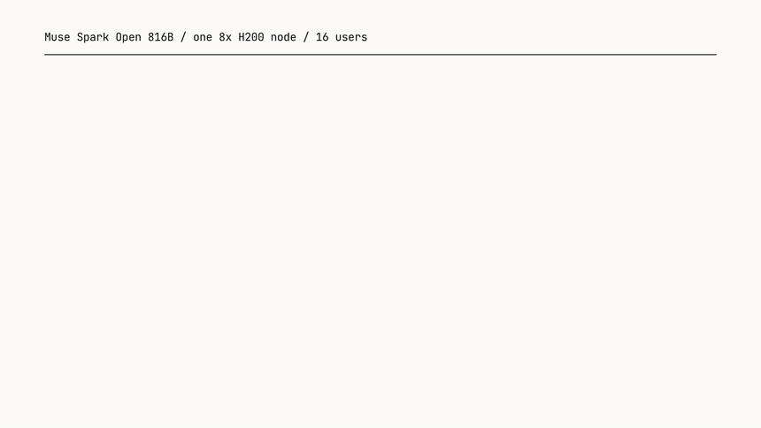
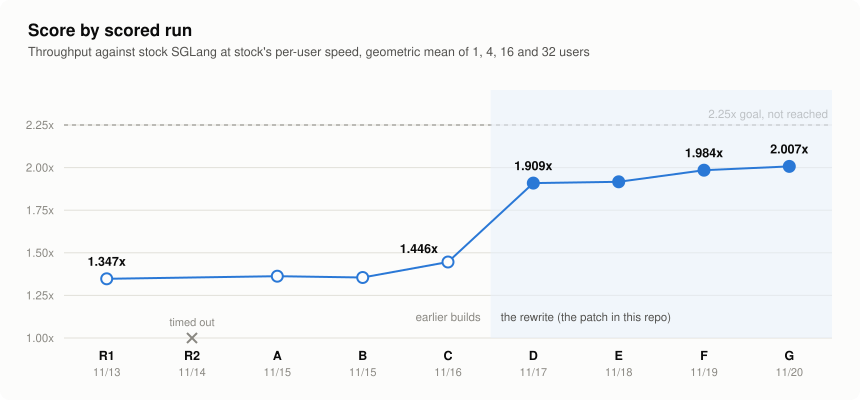
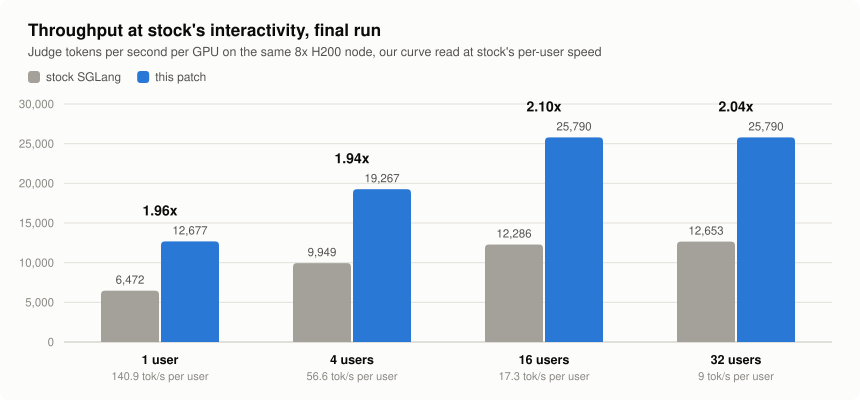
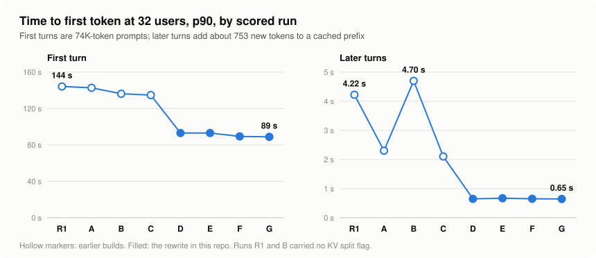
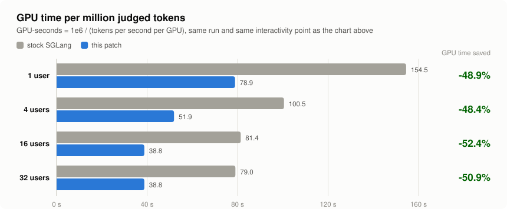
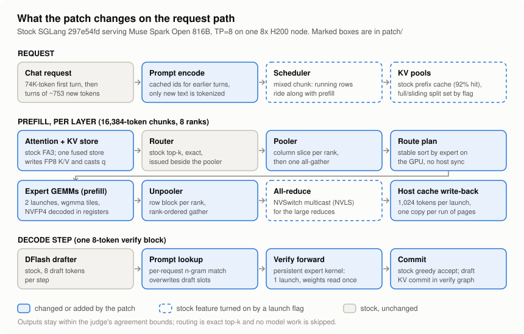
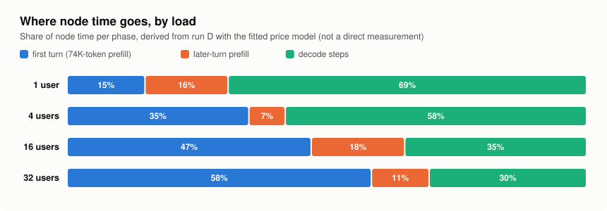

# Muse Spark Open Kernel Challenge 2026

A serving-track entry: a 208 KB patch to SGLang that serves Muse Spark Open (816B parameters, 4-bit experts) at
**2.007x** stock throughput on one 8x H200 node, with outputs inside the judge's agreement bounds.



| | |
|---|---|
| Final score | 2.007x (run G, Nov 20 2026), geometric mean of 1, 4, 16 and 32 users |
| Per load | 1.959x / 1.937x / 2.099x / 2.038x |
| GPU time per judged token | 50.2% lower than stock (derived from the same run) |
| Extra GPU memory | +0.4 GB over stock (limit 2 GB) |
| Patch | 20 files, 3,848 added lines, 208 KB (limit 400 KB). Hashes are in [`patch/README.md`](patch/README.md) |
| Base | SGLang `297e54fd` (v0.5.23), judge image `lmsysorg/sglang:dev-muse-spark-open` |
| Status | Provisional. The board was private during the track, so our rank is unknown, and final placements come from the organizers' reruns. |

Labels used in this repo: **m** measured, **d** derived from measurements, **g** guess. Scores and per-load numbers
come from the judge's result files, trimmed into [`results/runs.json`](results/runs.json).

## What the contest measured

The judge serves multi-turn agentic coding conversations on a whole 8x H200 node at 1, 4, 16 and 32 concurrent users.
Each conversation opens with a 74,160-token first turn and runs 13 turns, adding about 753 new tokens per turn and
generating 220 tokens per answer. The score is our throughput divided by stock SGLang's, read at stock's per-user
speed on the same node, then averaged geometrically over the four loads.

A patch has to be lossless: answers must agree with stock's, top-k routing must be exact, time to first token can be
at most 2x stock's at each load, and no model work may be skipped. Launch flags are fixed apart from a short allowed
list.

## How we worked

A few habits did most of the work, so they are written down here.

- **Price an idea before building it.** The score is a geometric mean, so every lever was priced as a gain in the
  natural log of the score: the time it saves in a pool, times that pool's share of node time at each load. A lever
  worth less than run-to-run noise did not get built.
- **Write the predicted score down before every run.** Predictions and outcomes are listed in
  [`docs/WHAT-DID-NOT-WORK.md`](docs/WHAT-DID-NOT-WORK.md). Of the seven on record, four landed within 1% and one
  missed by 23%.
- **Measure deltas on one rented H200, measure the system on the judge.** Kernel changes were compared in paired,
  rotated runs on a single GPU. Only the judge has the 8-GPU node and the real conversations, so the one scored run
  per day was the whole-system measurement.
- **Gate every send.** Format rules, a rules read of the exact file, and a line-overlap audit.

| Date (UTC) | What happened |
|---|---|
| Nov 4 | Kernel track closes. |
| Nov 12 | Serving track opens. First check runs sent the same day. |
| Nov 13 | Run R1 scores 1.347x. |
| Nov 16 | Run C scores 1.446x. We start a from-scratch rewrite of every kernel. |
| Nov 17 | Run D, the first build on the rewrite, scores 1.909x. |
| Nov 19 | Run F scores 1.984x. |
| Nov 20 | Run G scores 2.007x, an hour before the close. |

## Results

<picture>
  <source media="(prefers-color-scheme: dark)" srcset="assets/score-progression-dark.svg">
  
</picture>

Nine scored runs in eight days. Runs R1 to C were earlier builds (see [Provenance](#provenance)). On Nov 16 we
rewrote every kernel from scratch. Run D was the first build on the rewrite
and scored 1.909x against 1.446x for the build before it. We predicted 1.462x for it, so our price model was badly
low on that run. Runs E, F and G are that build plus the changes listed in
[`results/runs.json`](results/runs.json).

<picture>
  <source media="(prefers-color-scheme: dark)" srcset="assets/throughput-dark.svg">
  
</picture>

Final run, per load (m, judge):

| Users | Stock tok/s/GPU | Ours at stock's point | Ratio | TTFT p90 first turn | TTFT p90 later turns | Accepted tokens per verify |
|---:|---:|---:|---:|---:|---:|---:|
| 1 | 6,472 | 12,677 | 1.959x | 4.53 s | 0.166 s | 4.4 |
| 4 | 9,949 | 19,267 | 1.937x | 10.55 s | 0.204 s | 4.2 |
| 16 | 12,286 | 25,790 | 2.099x | 40.55 s | 0.289 s | 4.5 |
| 32 | 12,653 | 25,790 | 2.038x | 88.93 s | 0.646 s | 4.5 |

The "at stock's point" column is the judge's interpolation of our throughput curve at stock's per-user speed. The
16 and 32 user rows both read 25,790 because that is the top of our measured curve (the 32-user rung).

What the judge reported for the final run:



Correctness on the same run (m): prefill KL 0.05 (limit 0.11), decode KL 0.013 (limit 0.035), matching prefix 0.15
(floor 0.05) over 176 reference turns, rescored agreement 0.96 on first turns (floor 0.85) and 0.97 on later turns
(floor 0.92).

<picture>
  <source media="(prefers-color-scheme: dark)" srcset="assets/ttft-dark.svg">
  
</picture>

First-turn TTFT at 32 users fell from 144 s to 89 s. Later-turn TTFT fell from 4.22 s to 0.65 s. About half of the
later-turn drop is one launch flag (`--swa-full-tokens-ratio 0.3`, the split between the full and sliding KV
pools): the two runs without it, R1 and B, are the two spikes. The rest came with the rewrite.

## Estimated savings

<picture>
  <source media="(prefers-color-scheme: dark)" srcset="assets/gpu-time-dark.svg">
  
</picture>

The judge reports tokens per second per GPU, so GPU time per million tokens is `1e6 / tok_s_per_gpu` and the saving
is `1 - 1 / ratio`. That gives 48.9%, 48.4%, 52.4% and 50.9% at 1, 4, 16 and 32 users, 50.2% on the geometric mean
(d, [`results/savings.json`](results/savings.json)). Put another way, a fleet that needs 100 nodes of stock SGLang
for this workload at 16 users would need 48 (d).

Dollars depend on your GPU price, so here is the formula and one worked row. Cost per million tokens is
`rate x GPU-seconds / 3600`. At an assumed $3.00 per H200-hour (g, swap in your own rate):

| Users | Stock | This patch |
|---:|---:|---:|
| 1 | $0.129 | $0.066 |
| 4 | $0.084 | $0.043 |
| 16 | $0.068 | $0.032 |
| 32 | $0.066 | $0.032 |

What this estimate does not cover:

- It is one scored run, and the 32-user rung had a single repetition. Our one repeat read (runs D and E, bitwise-equal
  builds) differed by 0.4%.
- It is provisional until the organizers rerun the top entries on held-out data.
- It holds for this workload: long first turns, a 92% prefix-cache hit rate and short answers. A workload with
  short prompts would land elsewhere, because the patch's largest gains are in first-turn prefill.
- "Tokens" are the judge's throughput tokens. We did not re-derive what the judge counts.

## Architecture, and why

<picture>
  <source media="(prefers-color-scheme: dark)" srcset="assets/architecture-dark.svg">
  
</picture>

We started from where the node time goes, then built for the two regimes that showed up.

<picture>
  <source media="(prefers-color-scheme: dark)" srcset="assets/node-time-dark.svg">
  
</picture>

At 1 and 4 users, decode steps are 58 to 69% of node time. At 16 and 32 users, first-turn prefill is 47 to 58%
(d, from run D). Those two phases stress the routed experts in opposite ways, so the patch has two expert kernels
that share one weight layout.

**Decode and verify (up to 256 tokens): one persistent launch.** A decode step touches every routed expert but
gives each only a few tokens, so the time goes to reading weights. Our kernel runs once per call: a producer warp streams each expert's weight block into a
shared-memory ring a single time, tokens ride as the narrow operand of the matrix multiply, and the work is cut
into equal stage ranges per thread block (stream-K) so no block idles. See
[`okc_moe_decode.cuh`](patch/okc-serving.diff).

**Prefill (above 256 tokens): tiled tensor-core GEMMs.** A 16,384-token chunk gives each expert hundreds of rows,
so the time goes to math. Two launches per call, one per projection. Tiles are ordered expert-major so the thread
blocks running together share one expert's weights in L2. 4-bit codes are decoded to BF16 in registers and fed
straight to `wgmma`. Tiles size their multiply to the routes they hold: a 3,012-token call went from 956 to 789 us
(m, one H200). The output stores are staged into 16-byte writes, 4.7% off a 16K-token call (m). Stock's expert call
at 16,384 tokens took about 7,200 us per layer on our test GPU; ours took about 3,270 us before the staged stores
(m, one H200).

**One weight copy.** Both kernels read a stage-block layout (36,864 bytes per stage: codes then block scales, in the
order the consumer threads load them). Layers are repacked in place from the tensors stock already prepares, and
the stock copies are freed. That is why the whole patch costs 0.4 GB of GPU memory against a 2 GB limit.

**Same rounding points as stock.** The contest requires answers to match. Both kernels accumulate in FP32, round to
BF16, and multiply by the BF16 scale at the points stock's Marlin path does. Routing is stock's exact top-k.

**Fewer replicated GEMMs across the 8 ranks.** With TP=8, stock runs the pooler and unpooler projections in full on
every rank. Above a few thousand rows it is cheaper for each rank to compute a slice and gather. The thresholds are
measured, not assumed: splitting the unpooler by rows loses 3 us per call at 1,024 rows and saves 27 us at 2,048 and
572 us at 16,384 (m, 8 ranks, inside CUDA graphs), with outputs bitwise equal to the full GEMM.

**No host round-trips in the hot path.** The route plan (a stable sort of routes by expert) stays on the GPU, the
FP8 KV store is fused with the query cast FA3 needs anyway, and the draft KV commit moved inside the verify graph.

**Prompt lookup for agentic text.** Coding conversations repeat themselves. Before each verify, a per-request n-gram
match against the conversation's own tokens can overwrite the drafter's slots. Verification decides what commits, so
a wrong guess costs a step and never a token. Nothing is shared across requests.

**Every path falls back.** Layers that do not match the shapes these kernels were built and measured for (SM90,
32 local experts, 4,096 hidden) keep stock Marlin. The organizers said mergeability would count, so the patch is
written as something SGLang maintainers could read: 8 new files, 12 edited ones, licence headers on all.

Full write-up: [`docs/ARCHITECTURE.md`](docs/ARCHITECTURE.md).

## What did not work

- **The 2.25x goal.** We finished at 2.007x. Every lever left on Nov 19 needed a GPU we did not have.
- **Sequence-parallel norm boundaries (G1).** Passed correctness and read 0.988x of baseline at 16 users (m).
  Dropped.
- **Host-side tokenizer work.** A stand-in benchmark showed later-turn encode falling from 186 to 3.3 ms (m). The
  judge's later-turn TTFT did not move (0.170 s before and after, m). We had priced that pool from the stand-in and
  were wrong. The reuse code is in the patch and is harmless; it just did not pay here.
- **A persistent decode kernel for later-turn prefill.** 753-token calls got faster (584 to 443 us), but the larger
  tables cost 0.6 to 1.5 us per decode step per layer. Net about zero. Killed.
- **Consumer warpgroup ping-pong in the prefill kernel.** 843 to 857 us at 3,012 rows (m). Slower. Killed.
- **Porting our dense-projection kernel.** The small-batch gain needs 12-bit weight copies of 6.0 to 9.2 GB per GPU,
  over the 2 GB cap.
- **Run R2** hit the judge's time limit and scored nothing.

More in [`docs/WHAT-DID-NOT-WORK.md`](docs/WHAT-DID-NOT-WORK.md).

## What we would tell ourselves on day one

1. **A price model fitted to one code base does not transfer to another.** It called run D at 1.462x. The judge said
   1.909x.
2. **Price host-side work from the judge, not from a stand-in.** Our tokenizer lever looked like 180 ms per turn
   locally and measured zero where it counted.
3. **Launch flags are part of the design.** One KV pool ratio roughly halved later-turn TTFT at 32 users with no
   code change.
4. **Losslessness is a design input.** Keeping stock's rounding points decided the kernel structure early and meant
   no run ever failed agreement.

## Kernel track

Before serving opened we entered the five kernel problems (closed Nov 4). Final board positions (m, organizers'
boards after review):

| Problem | Speedup | Rank |
|---|---:|---:|
| Whole decoder layer | 2.250x | 272 of 1,297 |
| Gated attention decode | 2.574x | 399 of 1,380 |
| Routed experts | 2.315x | 468 of 1,423 |
| Prefill layer | 1.728x | 371 of 896 |
| Dense projections | 1.500x | 386 of 1,741 |

Kernel-track code is not part of this repo. The numbers are here for context.

## Use the patch

```bash
git clone https://github.com/sgl-project/sglang && cd sglang && git checkout 297e54fd
git apply ../patch/okc-serving.diff
pip install -e python --no-deps    # inside the judge image
```

Launch with the judge's flags (see [`patch/README.md`](patch/README.md)) plus the three we added:
`--swa-full-tokens-ratio 0.3 --enable-nccl-nvls --enable-mixed-chunk`.

## Repo map

| Path | What is in it |
|---|---|
| [`patch/`](patch/) | The scored patch, its sha256 and launch flags |
| [`results/`](results/) | Trimmed judge results for all nine scored runs, the savings table, kernel-track positions, the overlap audit |
| [`assets/`](assets/) | Charts (light and dark), the animated panels and two short clips |
| [`scripts/`](scripts/) | `build_results.py` trims the judge files; `make_charts.py` draws every chart from `results/` |
| [`docs/`](docs/) | Architecture, what failed, provenance, references |

## Provenance

Everything in `patch/` is our code or stock SGLang lines the patch edits. Runs R1 to C used earlier kernels that
we did not write, and those are not included. We ran a line-overlap audit of the final patch against the kernel
sources we had read. 19 of 20 files matched 0 to 3.4% of their lines. The prefill kernel
matched 7.3% (52 of 708 lines), above our own 5% flag, so we are showing it: the matches are instruction mnemonics
(`wgmma.mma_async.sync.aligned...`), register lists, CUDA driver enums and a handful of helper signatures that any
Hopper tensor-core kernel has to spell the same way. The table and the breakdown are in
[`docs/PROVENANCE.md`](docs/PROVENANCE.md).

## References

Papers we read while designing this. No code from them is in the patch.
[`docs/REFERENCES.md`](docs/REFERENCES.md) has the full list with arXiv IDs.

## Licence

Apache-2.0, matching SGLang. See [`LICENSE`](LICENSE) and [`NOTICE`](NOTICE).

